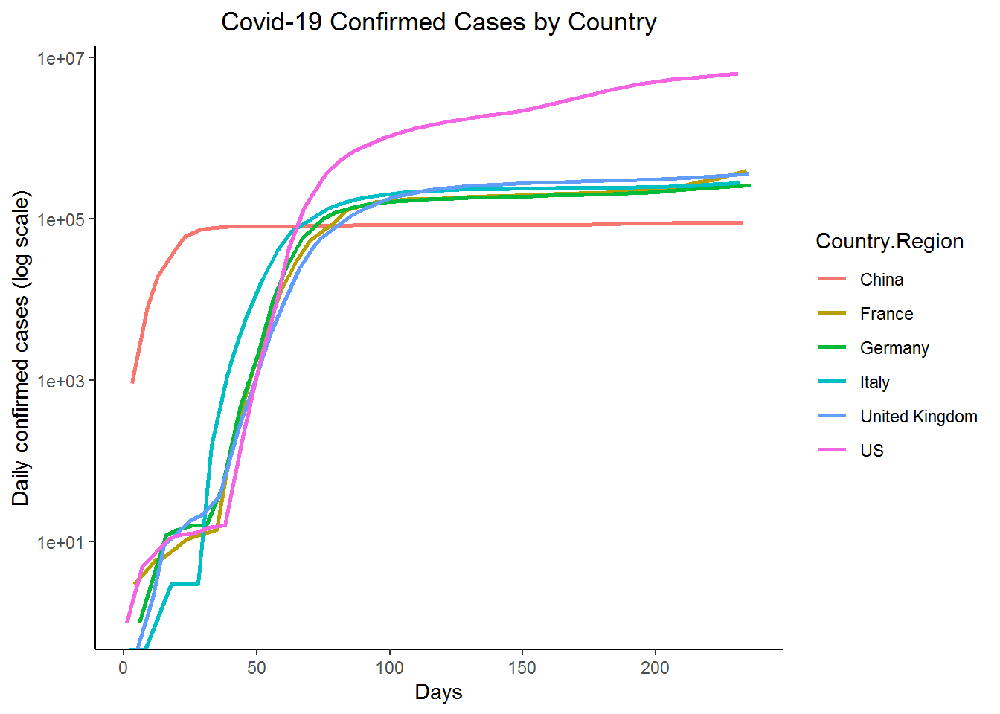

# How did COVID-19 spread, and how did countries compare?

A public-health dashboard and a set of R analyses that pull case counts from
open web sources and show how confirmed cases and deaths grew over 2020.

**Live dashboard:** [Covid-19 Dashboard on Tableau Public](https://public.tableau.com/profile/cheryltky#!/vizhome/Covid-19Dashboard_16184790425750/Dashboard1)

*Cumulative confirmed cases for China, France, Germany, Italy, the United
Kingdom and the US on a log scale, from the R analysis in
[covid19stats.Rmd](covid19stats.Rmd). I have not committed a screenshot of the
Tableau dashboard itself.*

## Project background

In early 2020 the questions people asked about COVID-19 were simple and urgent:
how fast are cases growing, how many people have died, and is my country
following the same path as others? Official counts were published as open data
files and application programming interfaces (APIs), which made it possible to
build views that refresh when the source does.

This project uses R and Tableau. It covers three areas:

- **Global trend:** confirmed cases, deaths and recoveries from the Johns
  Hopkins University (JHU) time series
- **Country comparison:** Belgium against Italy, Germany, Netherlands, France
  and Spain in an interactive flexdashboard
- **Australia:** state-level totals from a published tracking table

Links to the technical work:

- Global analysis: [covid19stats.Rmd](covid19stats.Rmd) (knitted: [covid19stats.html](covid19stats.html))
- Interactive dashboard: [covid19Dashboard.Rmd](covid19Dashboard.Rmd) (knitted: [covid19Dashboard.html](covid19Dashboard.html))
- Scripts: [scripts/](scripts/), including an animated chart script in [scripts/learning/gganimate.R](scripts/learning/gganimate.R)
- Animated output: [Figures/virusevolution.gif](Figures/virusevolution.gif)
- Tableau dashboard: [Tableau Public](https://public.tableau.com/profile/cheryltky#!/vizhome/Covid-19Dashboard_16184790425750/Dashboard1)

## Data

- **JHU CSSE COVID-19 time series.** Confirmed, deaths and recovered counts by
  country and province, read from the `CSSEGISandData/COVID-19` GitHub
  repository (three global CSV files) when the analysis is knitted.
- **`coronavirus` R package** (`RamiKrispin/coronavirus`). Daily cases by
  country and type (confirmed, death), used by the flexdashboard.
- **Australian tracking table:**
  [Data/australian-coronavirus-tracking-latest-totals.csv](Data/australian-coronavirus-tracking-latest-totals.csv).
  One row per state or territory plus a national row, with cumulative cases,
  deaths, recoveries, tests and hospitalisations. Its last-update column holds
  23/04/2020 and 24/04/2020.
- **Our World in Data** full-data file, used only in an exploratory script
  ([scripts/covid19spread.R](scripts/covid19spread.R)).

The JHU files are wide, with one column per date. The analysis reshapes them to
one row per country per day and sums provinces to country level.

## Executive summary

The dashboard shows Belgium at **85,042 total confirmed cases and 9,894 deaths,
an 11.6% death rate** (deaths divided by confirmed cases), as rendered in
[covid19Dashboard.html](covid19Dashboard.html). The global analysis shows
cases rising slowly for the first weeks and then steeply, with China levelling
off early while the US climbed furthest of the six countries compared. Counts
are a snapshot, so they describe the data at the time it was knitted, not today.

## Insights

### Belgium dashboard

- **85,042 confirmed cases and 9,894 deaths (11.6%)** are the headline tiles
  on the Summary page, calculated from the package data in the rendered file.
- **Three events are annotated on the cumulative chart:** first case on
  2020-02-04, first death on 2020-03-11 and lockdown on 2020-03-18. These dates
  are typed into the dashboard code, not calculated from the data.
- **The Comparison page** plots daily new confirmed cases for Belgium, Italy,
  Germany and the Netherlands from 2020-02-29, and total confirmed cases and
  deaths for Belgium, France, Italy and Spain.

### Global and country trends

- **Cumulative counts rise slowly, then steeply.** On the log-scale chart the
  France, Germany, Italy, UK and US lines follow a similar steep rise before
  flattening at different levels.
- **China levels off early.** Its line is the first to flatten, well before
  the other five countries.
- **The US ends highest** of the six countries on that chart.

### Australia snapshot

- **6,673 confirmed cases and 78 deaths nationally** in the tracking table,
  with 5,042 recovered and 1,553 active.
- **461,949 tests with 1.4% positive**, and 338 people in hospital, 41 in
  intensive care and 32 on ventilators.
- **New South Wales had the most confirmed cases at 2,982**, ahead of Victoria
  at 1,343 and Queensland at 1,026.

## Recommendations

For anyone reusing this work to track an outbreak:

- Counts change daily and the sources are revised. **Show the snapshot date on
  every chart and tile.**
- Raw confirmed counts depend on how much testing is done. **Pair cases with
  tests and positivity before comparing countries.**
- Hand-typed annotations go stale. **Derive event dates from data, or record
  their source next to the code.**

## Assumptions and caveats

- **Snapshot dates differ by file.** The Australian table is dated 23 and 24
  April 2020; the animated chart title reads 2020-08-02; the dashboard HTML
  does not record the date its package data ended.
- **Reporting lags and revisions.** Counts reflect when cases were reported,
  not when they occurred, and countries changed their definitions over time.
- **Cumulative totals are plotted under "daily" axis labels.** The JHU files
  hold running totals, so some chart axes are mislabelled, and the "all types"
  chart adds a second cumulative sum that distorts its scale. These are known
  issues in the exploratory code and have not been fixed.
- **The country selection filter** in the global analysis compares each row
  with a list of countries using `==`, so only some dates per country are kept.
- **Death rate is deaths divided by confirmed cases**, which overstates the true
  fatality rate when testing is limited.
- The repository's knitted HTML files predate the file renames in this tidy-up
  and were not regenerated.

## Technical detail

- How to knit and run it: [docs/SETUP.md](docs/SETUP.md)
- Practice scripts from tutorials: [scripts/learning/](scripts/learning/)
